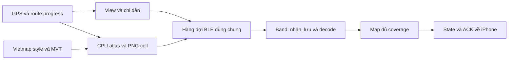

# Nghiên cứu stream bản đồ dưới 1 giây

Ngày: 2026-10-10. Mã được rà soát: `07cb57977b0133b91a1e25937ea69b5b241384b4`.

Yêu cầu đã xác nhận: dưới 1 giây cho **khởi tạo, di chuyển, rẽ và đổi vùng bản đồ**. Người dùng đã nâng từ iOS 26 lên iOS 27; firmware Band 10 không đổi. Chưa có model iPhone, số build iOS/firmware cụ thể hoặc đường dẫn trace mới. Đây là báo cáo nghiên cứu và đề xuất thử nghiệm, chưa phải ADR chấp nhận kiến trúc mới hay kết quả nghiệm thu thiết bị.

## Kết luận kỹ thuật

Hướng ưu tiên là bản đồ được lưu và dựng sẵn trên Band, kết hợp các lệnh cập nhật trạng thái nhỏ. Dự án đã có nền tảng này qua corridor streaming. Việc cần làm tiếp là giảm thời gian chờ của lệnh điều khiển, chuẩn bị đủ vùng sắp đi tới và tránh tải lại toàn màn hình mỗi lần camera đổi hướng/zoom.

Không có bằng chứng hiện tại để cam kết toàn bộ yêu cầu dưới 1 giây. Đặc biệt, khởi tạo khi chưa có GPS/tuyến/tile/kết nối phụ thuộc các công việc không có thời gian đáp ứng tối đa dưới 1 giây. Chuẩn bị trước có thể giúp lần Start đã sẵn dữ liệu đạt mục tiêu, nhưng phải báo riêng thời gian chuẩn bị và lần mở hoàn toàn mới; không đổi mốc bắt đầu để biến cold start chậm thành PASS.

Tăng cửa sổ truyền hoặc nén ảnh thêm có thể giúp, nhưng không tự giải quyết chờ GPS/provider, đổi camera, giải mã trên Band và hàng đợi phản hồi. Chưa có cơ sở chọn thay giao thức Xiaomi, bỏ ACK/hash hoặc viết lại toàn bộ renderer.

## 1. Phạm vi bằng chứng và lịch sử

Đã đối chiếu lịch sử Git, các ADR 0011–0020 có liên quan, handoff, kế hoạch performance, mã Swift/Vela, test và CI workflow. Kết quả CI cũ dưới đây là **nội dung đã ghi trong repository**, không phải CI vừa được chạy lại. Không tìm thấy trace phần cứng mới trong các file được liệt kê bằng `rg --files` của checkout; điều đó không chứng minh người dùng không có log ở nơi khác.

Baseline `/home/hainn/blue/code/blueband-ios` không có trong môi trường Windows hiện tại. Thư mục `E:/code/blueband-ios` chỉ có thư mục `.git` và Git không nhận diện được checkout; không dùng nó làm nguồn xác nhận byte và không sửa nó. Nhận định về baseline phần cứng dựa trên tài liệu đã có trong repo map, không phải lần kiểm chứng độc lập mới.

| Giai đoạn | Bằng chứng trong lịch sử | Bài học còn áp dụng |
| --- | --- | --- |
| Cuối tháng 8 | M1, H1, Static Map và các thử nghiệm raster/vector; [nghiên cứu cũ](map-navigation-feasibility.md) | Hiển thị được một ảnh chưa chứng minh cập nhật liên tục. Nguồn ảnh và UI quảng bá của SDK không chứng minh khả năng trên Band. |
| 02–03/09 | `4ad102c`, `7ebb963`, `d80a074`, `12f3984`: background modes, quyền sở hữu GPS, bỏ truy vấn đồng bộ khỏi luồng thời gian thực, renderer CPU | iPhone khóa màn cần luồng location/BLE đúng vòng đời; GPU snapshot và CPU background là hai đường cần kiểm tra riêng. |
| 03–04/09 | [ADR 0014](../adr/0014-bounded-application-ack-recovery.md), [0015](../adr/0015-hardware-safe-stop-and-wait-map-transfer.md), [0016](../adr/0016-preserve-map-state-on-native-send-timeout.md) | Trace cũ dừng ở ACK 4/18, 7/18 rồi 3/18. Stop-and-wait cũng không giải quyết được lỗi đó. Không suy nguyên nhân duy nhất là concurrency. Retry phải giữ nguyên ID/nội dung; timeout 204 không được xóa dữ liệu đã nhận. |
| 04/09 | `c7c7dfc`, `50d344a`, `15ec415`: kết quả hiển thị đến muộn, timer cũ, camera hairpin | Callback và timeout cần gắn đúng run/scene. Camera không thể ép mọi điểm rẽ nằm phía trước. |
| 04–07/09 | [handoff latency](../testing/handoffs/map-refresh-latency.md), [handoff resume](../testing/handoffs/navigation-resume-and-exits.md) | Từng ghi nhận một frame có tuổi GPS 11.347 ms; log khác là 5.454 ms. Các số đo window 1/2/4 với ACK giả lập 500 ms là test, không phải throughput BLE. |
| 07–09/09 | `452cc4d`, `5e948c7`: reset có xác nhận, chuẩn bị frame kế tiếp chồng với transfer | Một frame đang truyền, chuẩn bị hữu hạn; không để timeout khóa vĩnh viễn luồng cập nhật. |
| 10–12/09 | `e3499d7`, `43dec58`, `6db094b`: corridor; `80bedda`, `3f797cc`, `0a24664`, `6b91064`: sửa vòng chờ decode, ưu tiên prefetch, tách worker và preview | Kiến trúc tile đã triển khai. Không đề xuất lại như một tính năng chưa tồn tại. Phản hồi thiết bị trong [ADR 0019](../adr/0019-bounded-corridor-map-streaming.md) vẫn ghi nhận cadence chưa đủ. |
| 19/09 | `e1657a4`, `38ae796`, `20d4020`, `07cb579`: trace, analyzer, sửa SwiftUI type checking | Đã có dụng cụ đo. [Kế hoạch bàn giao](../superpowers/plans/2026-09-19-map-performance.md) ghi iOS 0.5.23 (39), RPK 0.6.18 (33); chưa có hardware acceptance từ đợt triển khai đó. |

Các lỗi build/thực thi cần tránh tái diễn:

- Linux parse Swift không thay Apple type checking; export view quá lớn từng vượt khả năng suy luận SwiftUI. Phải chạy iOS CI cho thay đổi phía app.
- RPK build thành công chưa chứng minh firmware chạy được custom module loader. `apps/band/test/bundle-contract.test.mjs` kiểm tra entry thực sự sau build, giữ module table rỗng và API level 1.
- File ảnh nhỏ không đồng nghĩa tốn ít RAM sau decode; URI cũ, callback muộn và file chưa xóa có thể giữ thêm tài nguyên.
- Cài nhầm IPA/RPK hoặc còn cache RPK cũ làm kết quả vô nghĩa. Ghi version/build và hash của cặp cài thực tế.
- Mi Fitness tranh quyền phiên, AuthKey sai, quyền Bluetooth/location, RPK chưa ready là các lỗi vận hành đã có trong [troubleshooting](../development/troubleshooting.md).
- Chạy lệnh qua `make` với container pin trong `compose.yaml`: Swift 6.3.3 và Node 20.19.5. Không thay bằng Node host để tuyên bố kiểm chứng tương đương.

## 2. Định nghĩa đúng mục tiêu

| Trường hợp | Bắt đầu đo | Điểm kết thúc và điều kiện |
| --- | --- | --- |
| Khởi tạo | Người dùng yêu cầu bắt đầu điều hướng | Bản đồ đúng tuyến/vị trí, marker và chỉ dẫn đầu tiên xuất hiện. Tách đã kết nối/chưa kết nối, có cache/không cache; cả hai vẫn nằm trong báo cáo yêu cầu khởi tạo. |
| Di chuyển | `CLLocation.timestamp` của fix hợp lệ | View tương ứng xuất hiện, không chỉ hoàn tất gửi chunk hoặc nhận ACK. |
| Rẽ, đổi zoom/vùng | Fix hoặc thao tác gây thay đổi cần hiển thị | Camera/route/marker/HUD mới nhất đúng và đủ coverage. Giữ ảnh cũ trong lúc chờ là chống nháy, chưa phải cập nhật đạt hạn. |
| Band ngủ rồi thức | Mốc thức quan sát được | Đo thời gian bắt kịp vị trí mới. Không có pixel để đánh giá khi màn đang tắt; ghi tình trạng không khả dụng, không tự tính PASS. |

Thước đo ứng dụng: `L_confirm = gpsInputAgeMs + appToConfirmMs`. Thước đo người dùng: `L_visible = thời điểm pixel đúng xuất hiện - timestamp fix`. Xác nhận ứng dụng có thêm đường phản hồi BLE nhưng vẫn không bảo đảm thời điểm scanout; cần video hoặc phép đo quang đồng bộ để đối chiếu. Event `complete` của Vela chỉ xác nhận ảnh đã tải xong theo [tài liệu image](https://iot.mi.com/vela/quickapp/en/components/basic/image.html).

Ghi p50/p95/p99/max, số mẫu `>=1000 ms`, fix không được xác nhận, khoảng đứng hình, và số reset epoch. Mục tiêu nghiêm ngặt là mọi mẫu hợp lệ trong ca dưới 1000 ms; p95 tốt không che được các lần vượt hạn. Một ca hữu hạn PASS không trở thành bảo đảm trong mọi điều kiện sóng/GPS/mạng.

GPS 1 Hz cộng độ trễ 200 ms có thể cho các khung cách nhau khoảng 1 giây nhưng mỗi fix vẫn đến sớm. Ngược lại, nội suy ở 10 FPS không tạo thêm dữ liệu GPS thật. Độ trễ xử lý, nhịp khung và tuổi dữ liệu đang hiển thị cần được báo riêng.

**Khoảng trống hiện tại:** `tools/perf/report.py` chỉ fail độ trễ xác nhận khi `initial == false`; trace khởi đầu ở `startNavigation` sau kiểm tra ready/config. Vì vậy phải bổ sung gate khởi tạo từ thao tác người dùng đến frame đầu; first-fix-to-confirm không bao gồm toàn bộ chờ GPS/route trước đó. Không dùng PASS hiện tại để tuyên bố đã đáp ứng yêu cầu mới. Không thay đổi analyzer trong đợt nghiên cứu này.

## 3. Pipeline hiện tại

- Bootstrap/recovery dùng ảnh 212×520, payload tối đa 8 KiB. `AppModel` chọn window 4, dù default của `RouteCardRenderCoordinator` là 1. Cần đọc nơi khởi tạo thực tế để tránh kết luận nhầm đang stop-and-wait.
- Corridor dùng PNG 128×128, chunk 216 byte, một cell transfer, tối đa 4 chunk mỗi nhóm. `map.stream.view` chứa dịch chuyển tuyệt đối và sequence, có worker độc lập với cell worker.
- Band giữ tối đa 30 file cell ổn định, 31 khi có hoạt động tạm được xác định, 24 image node; view có tối đa 18 cell. Chỉ promote khi đủ ảnh giải mã, giữ scene/epoch/hash và loại callback cũ.
- iPhone có hai atlas nền 768×768 ở 2x, tổng 18 MiB RGBA retained; cache MVT 16 tile/24 MiB, tối đa bốn HTTP request. Route được vẽ thêm sau crop.
- Phân biệt ba giới hạn: application envelope tổng quát 1024 byte; full-frame planner giới hạn 940 byte để chừa wrapper; reply/perf phía Band giới hạn 512 byte. Không nhầm các giới hạn này với `maximumWriteValueLength` của CoreBluetooth hoặc raw cell bytes.
- Cache file chưa chắc cache decode: `corridorMap.images()` chỉ mount current/wanted; file ngoài resident bị đánh dấu chưa decoded. Prefetch hiện tại chủ yếu đưa file đến trước, vẫn có thể cần decode khi đi vào view.

## 4. Các điểm nghẽn cần đo và thử

Các hành vi mã dưới đây đã xác định bằng đọc source. Mức đóng góp vào độ trễ thiết bị vẫn là giả thuyết cần trace.

| Ưu tiên | Vị trí và hành vi | Hệ quả / thử nghiệm |
| --- | --- | --- |
| P0 | `AppModel.drainUpdates`: chờ ACK rồi sleep thêm 1 giây | Chỉ dẫn rẽ mới có thể chờ gần 1 giây trước khi được gửi. Luồng view không dùng sleep này; không quy mọi trễ map về nó. Thử lịch gửi theo deadline với trạng thái mới nhất. |
| P0 | `BandTransport.consume`: ghi SPP ACK xong mới yield data; `writeWaiters` là FIFO | Phản hồi vào có thể chờ ghi ACK sau các frame ảnh. Thử ưu tiên control tại ranh giới frame, đo cả thời gian nhận vật lý đến dispatch sự kiện. |
| P0 | `InterconnectSession.receive`: chờ gửi application ACK trước khi yield message | Một `map.stream.state` đã về vẫn có thể chờ đường gửi trước khi AppModel thấy nó. Phải giữ ownership/dedup khi tối ưu. |
| P0 | `AppModel.acceptsCorridor`: heading lệch >15°, zoom khác hoặc jump >128 px sẽ reset | Rẽ thường đưa hệ thống về full-frame rồi nạp corridor lại. Đây là trở ngại kiến trúc cho phạm vi mục tiêu mới. |
| P1 | `CorridorLink.sendCell`: `stride(...by:4)` + `waitForAll()` | Đây là nhóm 4 có barrier, chưa phải cửa sổ trượt liên tục. Có thể để trống slot khi một ACK trong nhóm chậm. |
| P1 | `index.ux.sendEnvelope`: gọi native send ngay, chỉ có `fail`, chưa quản lý `success` | Chưa quan sát/điều tiết được outbound backpressure. Thử đo callback và queue hữu hạn; không mặc định serialize tất cả sẽ nhanh hơn. |
| P1 | Prefetch một bước ≤128 px theo điểm maneuver | Chưa dựa vào thời gian đến biên, tốc độ và goodput; hướng đến maneuver xa có thể bỏ qua độ cong của route. |
| P1 | File prefetch chưa resident; `syncStreamImages` tạo lại array/style của các cell | Decode lúc qua biên và chi phí cập nhật UI có thể nằm trên đường tới frame. Thử giữ một số ô sắp vào view đã decode trong cùng budget. |
| P1 | Full frame phải confirmed trước `map.stream.open`; stream mới có cache cell rỗng | Lần mở đầu còn cần nạp các cell trùng vùng ảnh đầu để chuyển sang stream. Đây là hai giai đoạn cần đo riêng. |
| P1 | `runNavigation`: chờ GPS → gọi route → render → transfer/display | Startup chưa chuẩn bị trước tất cả dữ liệu, chưa thể mặc định dưới 1 giây. |
| P2 | GPS chấp nhận fix có tuổi tới 5 giây; recovery retry bắt đầu sau 1 giây không ACK | Một fix đã cũ hoặc một mất ACK có thể vượt SLA trước khi tối ưu renderer giúp được. Giữ thống kê vi phạm; không loại fix chậm để làm đẹp kết quả. |

Source chính: [AppModel](../../apps/ios/App/AppModel.swift), [CorridorLink](../../packages/BlueBandKit/Sources/BlueBandMapCore/CorridorLink.swift), [BandTransport](../../packages/BlueBandKit/Sources/BlueBandCore/BandTransport.swift), [InterconnectSession](../../packages/BlueBandKit/Sources/BlueBandCore/InterconnectSession.swift), [Band page](../../apps/band/src/pages/index/index.ux).

## 5. Chi phí truyền và vùng chuẩn bị trước

Một màn 212×520 RGBA là 440.960 byte, khoảng 430,6 KiB. Một cell 128×128 RGBA là 64 KiB; 24 cell là 1,5 MiB, chưa tính overhead native và ảnh full-frame. Đây là phép tính kích thước pixel, không phải số RAM đã đo trên Band. PNG nén 8 KiB vẫn có thể decode thành lượng pixel lớn hơn nhiều.

216 byte thành 288 ký tự Base64, tăng 33,3% trước JSON/wrapper/BLE. Thay JSON bằng binary không tự xóa các vòng chờ begin/end/ACK/decode. Cần đo goodput ở đúng tầng thay vì lấy tốc độ PHY quảng cáo làm tốc độ ứng dụng.

Mô hình minh họa, **không phải benchmark**: truyền cell với nhóm 4, giả sử mỗi nhóm mất một RTT hiệu dụng R, bỏ qua thời gian phát tuần tự và các bước khác:

`T_chunks ≈ ceil(ceil(B / 216) / 4) × R`

| Cell | Chunk | Nhóm | R=100 ms | R=250 ms |
| --- | ---: | ---: | ---: | ---: |
| 2 KiB | 10 | 3 | 300 ms | 750 ms |
| 4 KiB | 19 | 5 | 500 ms | 1250 ms |
| 8 KiB | 38 | 10 | 1000 ms | 2500 ms |

Còn phải cộng begin/admission, end/result, render, file write, decode và lịch UI. Bảng này minh họa tại sao cell cần đến **trước** khi camera cần nó; không suy RTT thật bằng 100/250 ms. Full-frame dùng chunk động khác nên không áp nguyên bảng cho full-frame.

Tính runway theo route thay vì một số cell cố định:

`prefetchDistanceMeters ≥ speedMps × p99(prepare + queue + transfer + write + decode) + dự phòng`

Ví dụ theo phép chiếu 512 px của mã: vĩ độ 21°, zoom 17 có khoảng 0,558 m/px. 128 px tương đương 71,4 m, tức 5,7 giây ở 45 km/h. Nếu nạp hàng mới gồm 2–3 cell mất gần thời gian đó, lề một cell không đủ dự phòng. Dùng điểm đi trước trên polyline thực tế, ưu tiên theo thời điểm đi vào viewport; giữ budget hiện hành.

Điều kiện bền vững là lượng byte cell mới cộng recoloring mỗi giây phải nhỏ hơn goodput hữu dụng còn lại sau control/retry, có dư địa cho jitter. Cần đo cả hàng dọc, cột ngang, đường chéo và vùng nhiều nhãn, không chỉ tuyến thẳng dễ nén.

## 6. Phương án đề xuất

| Phương án | Khả năng phục vụ mục tiêu | Quyết định nghiên cứu |
| --- | --- | --- |
| Nén/gửi full-frame nhanh hơn | Có ích cho bootstrap/recovery, vẫn gửi ảnh khi rẽ | Giữ làm đường khôi phục; không chọn làm đường cập nhật chính. |
| Corridor hiện có + control ưu tiên + prefetch theo thời gian | Tận dụng phần lớn mã đã có; tốt cho movement/new coverage | Ưu tiên thử đầu tiên. |
| Nền cố định hướng Bắc, marker đổi hướng | Hạn chế reset heading, chữ ít bị xoay | Đối chứng hiệu năng. Là thay đổi trải nghiệm so với heading-up, chưa tự chọn thay yêu cầu người dùng. |
| Dịch/xoay scene đã lưu trên Band | Chỉ cần gửi pose nhỏ khi rẽ, phù hợp heading-up | Ứng viên chính nếu native transform, clipping, chữ và bộ nhớ đạt trên firmware hiện tại. |
| Chuẩn bị camera/scene kế tiếp rồi chuyển atomically | Có thể giữ chữ thẳng và camera hiện tại | Phương án nếu xoay native không đạt; phải nằm trong cùng budget, có route/epoch validation và hủy khi đi khác dự đoán. |
| Vector scene tối giản cho tuyến/đường | Có tiềm năng ít byte hơn | POC sau; H1 chưa chứng minh hiệu năng native. Không coi route-only/arrow là bản đồ đầy đủ để đánh dấu đạt. |
| Pixel delta/XOR/video | Có thể giảm byte khi frame ít đổi | Chưa phù hợp ưu tiên: cần đường giải mã/composite được xác nhận, baseline đồng bộ; xoay map đổi rất nhiều pixel. |
| L2CAP/Wi-Fi/transport mới | Có thể nhanh trên thiết bị hỗ trợ | Chưa có endpoint/API Band được xác nhận trong dự án. Không phải lựa chọn có thể triển khai chỉ bằng sửa iOS. |

### A. Tối ưu scheduling trước khi thay wire

Đề xuất thứ tự phục vụ: ACK/điều khiển vòng đời → view và chỉ dẫn mới nhất → cell thiếu sắp phải hiển thị → prefetch → recoloring không khẩn cấp. Có chống starvation cho cell, chỉ một bản pending của trạng thái có thể thay thế. Không hủy nửa SPP frame để chen lệnh, không đổi thứ tự fragment, không đổi ID hoặc bytes của retry.

Đặt quyết định ưu tiên trước khi gán sequence/serialize ở lớp thích hợp; kiểm tra riêng SPP ACK có sequence tương ứng frame nhận. Không tùy tiện sắp xếp lại các frame đã đóng gói. Giữ acceptance/dedup/epoch guards khi giảm chờ ACK trên đường nhận.

Thử cửa sổ trượt tối đa 4 với **base offset được ACK liên tục**, không chỉ đếm số task đang chạy. Band đang từ chối `offset > received + 648`; một sender giữ bốn task nhưng nhảy qua lỗ hổng cũ vẫn có thể bị reject. Cần literal vector cho ACK đảo thứ tự, chunk chậm/mất và exact retry trước khi thay lịch.

Native Band send cần đo success/fail/queue depth để chọn credit hữu hạn. Timeout 204 vẫn bảo toàn accepted state; disconnect thật và callback epoch cũ vẫn xử lý riêng. [Interconnect chính thức](https://iot.mi.com/vela/quickapp/en/features/network/interconnect.html) có callback success/fail, phân biệt 204 với 1006; nó không xác nhận root cause của các trace dự án.

`CoreBluetoothBandLink` hiện ưu tiên `.withResponse` khi characteristic có `.write`; `.withoutResponse` chỉ ở nhánh còn lại. Ghi lại properties, write type và kích thước write thực tế trước khi A/B. Apple cung cấp [maximumWriteValueLength](https://developer.apple.com/documentation/corebluetooth/cbperipheral/maximumwritevaluelength%28for%3A%29?changes=la) theo write type và [canSendWriteWithoutResponse](https://developer.apple.com/documentation/corebluetooth/cbperipheral/cansendwritewithoutresponse?changes=_9&language=objc) để backpressure. Không giả định Band hỗ trợ write mode khác, MTU lớn hơn hoặc throughput cụ thể; thay transport behavior cần vector/ADR/hardware gate theo AGENTS.md.

### B. Tránh decode/network trên đường cập nhật thường xuyên

Giữ nền và route geometry ổn định theo epoch; chỉ cập nhật vị trí, hướng, khoảng cách và trạng thái thật sự thay đổi. Recoloring đường đã đi hiện đã được giới hạn theo cell, nên tối ưu tiếp phải dựa trên số byte thực tế còn lại; không bỏ tính năng để giả đạt map latency.

Giữ một vùng phía trước đã decode bằng những slot còn trống trong 24 node. Không predecode toàn bộ 30 file. Khi không đủ slot, chọn theo deadline và giữ viewport đang thấy. Thử giảm số lần tạo lại list/style hoặc dịch container chung khi không có thay đổi coverage. Xiaomi khuyến nghị hạn chế dữ liệu reactive không cần thiết và tránh tạo lại object tùy tiện trong [hướng dẫn bộ nhớ](https://iot.mi.com/vela/quickapp/en/guide/best-practice/memory.html); lợi ích trên page này vẫn phải đo.

### C. Giải quyết rẽ và đổi zoom

Vela tài liệu hóa `translate`, `rotate`, `scale` và `transform-origin`, nhưng `transition-property: transform` chưa hỗ trợ. Đó là cơ sở làm POC transform trực tiếp, chưa phải bằng chứng Band 10 đạt FPS/độ trễ yêu cầu. Không dùng giả định từ browser CSS. [Nguồn: animation styles](https://iot.mi.com/vela/quickapp/en/components/general/animation-style.html).

POC phải giữ map/route/marker/đích cùng hệ tọa độ; đo 0/15/45/90/180°, nhãn xoay, mép ảnh và clipping. Một bẫy budget: hình chữ nhật 212×520 xoay 45° có bounding box khoảng 518×518; nếu nạp toàn bộ bounding box trên lưới 128 px, cần 25–36 ô tùy căn lưới, vượt 24 node. Đây là bounding-box coverage bảo thủ, không phải số ô giao đa giác tối thiểu. Phải tính giao viewport thực hoặc chọn một bố trí ảnh khác, không tăng trần RAM mặc định.

Nếu transform không đạt, thử chuẩn bị scene theo đoạn route sắp tới và chuyển camera khi scene đó sẵn sàng, đồng thời kiểm tra GPS mới nhất. Cần chứng minh cả old/new images trong lúc chuyển không vượt ngân sách. Đổi hướng đột ngột/reroute chưa biết trước vẫn phải ghi thời gian thực, không âm thầm loại khỏi gate.

### D. Khởi tạo dưới 1 giây

Khi người dùng đã chọn đích, có thể chuẩn bị GPS, route, style, tile, raster và nạp Band trong giai đoạn xem trước. Ghi mốc `prepare.request`, `prepare.ready`, `start.intent`, `first.confirmed`; nếu đã hiển thị preview, đo riêng chuyển sang điều hướng đúng vị trí mới. Không đổi tên thời gian tải thành thời gian chuẩn bị rồi bỏ khỏi trải nghiệm được báo cáo.

Nguồn Vietmap có [Route v4](https://maps.vietmap.vn/docs/vi/map-api/route-version/route-v4/) và [Tilemap](https://maps.vietmap.vn/docs/vi/map-api/tilemap/); các trang đã đọc không cung cấp bằng chứng cho cam kết tổng cold-start dưới 1 giây. Cache route phải gắn origin/destination/profile/độ mới; cache tile/ảnh dẫn xuất phải theo quyền sử dụng provider hiện có. Không cần gọi API live hoặc dùng khóa của người dùng để thực hiện nghiên cứu này.

Một yêu cầu bắt đầu hoàn toàn mới, đích chưa biết, chưa có GPS hay dữ liệu map vẫn là **chưa chứng minh đạt**, kể cả sau các tối ưu trên. Muốn bảo đảm khởi tạo không phụ thuộc mạng cần nguồn route/map đã có cục bộ và cơ chế kết nối/GPS sẵn sàng; Band hiện tại và dự án chưa có bằng chứng đáp ứng toàn bộ điều kiện ấy.

## 7. Thứ tự thử nghiệm và tiêu chí ra quyết định

Giữ một bộ baseline trên iOS 27, firmware hiện tại, cùng cặp IPA/RPK, tuyến và seed. iOS 26 chỉ là lịch sử nếu không còn thiết bị để so sánh; không gán chênh lệch cho hệ điều hành khi đồng thời đổi nhiều biến. Apple mô tả background location có yêu cầu vòng đời riêng trong [hướng dẫn Core Location](https://developer.apple.com/documentation/corelocation/handling-location-updates-in-the-background?changes=latest_maj_8__2&language=objc); chưa kiểm chứng tương thích iOS 27 trong lần nghiên cứu này.

| Đợt | Thử nghiệm cụ thể | Quyết định dựa vào kết quả |
| --- | --- | --- |
| 0 | Chạy [T01–T06](../manual-tests/2026-09-19-map-performance.md), export JSONL sau từng phiên. Bổ sung lần Start có/không cache, đã/chưa kết nối; không dùng PREPARE 90 giây để loại startup. | Phân bổ thời gian queue/write/ACK/provider/encode/file/decode/apply; thống kê reset reason và cell bytes. |
| 1 | View trong coverage đã decode: không truyền cell; lặp cùng mẫu trong khi đang truyền cell. So sánh thêm bật/tắt đo hiệu năng trong một ca riêng. | View vẫn chậm khi không tải ảnh: ưu tiên control/native UI. Chỉ chậm khi tải ảnh: ưu tiên queue và outbound backpressure. |
| 2 | Qua biên có file chưa decode; sau đó qua biên thiếu file. So sánh các cell từ vùng ít/nhiều nhãn. | Tách decode miss khỏi transfer miss; chọn predecode và runway từ p99 thực. |
| 3 | POC camera fixed, dịch/xoay cached scene, hoặc staged camera; mọi mẫu cùng route. | Chọn cách giữ heading-up và budget khi rẽ. Không dùng kết quả đoạn thẳng thay nghiệm thu rẽ. |
| 4 | Startup mới hoàn toàn và startup đã chuẩn bị; rẽ 45/90/180°, đổi zoom, reroute, iPhone khóa, Band sleep/wake; chạy dài 30 phút. | Báo riêng từng nhóm nhưng mục tiêu đầy đủ chỉ đạt khi mọi nhóm bắt buộc đạt; dữ liệu thiếu là INCONCLUSIVE. |

Đề xuất phân bổ để thiết kế ca warm, chưa phải số đo: tuổi GPS 150 ms + xử lý/queue 100 ms + control/ACK 300 ms + apply/confirmation 150 ms + dự phòng 200 ms = 900 ms. Tổng từng mẫu phải được đo trực tiếp; không cộng p99 từng stage rồi gọi đó là p99 toàn pipeline. Ca cold cần thêm tải dữ liệu và không được giả dùng budget warm.

Video cần thấy nhãn frame cùng chuyển động map và một mốc thời gian đối chiếu; nhãn đổi nhưng pixel không đổi chưa chứng minh render. App/Band clock không đồng bộ nên chỉ lấy duration trên cùng clock. Giữ trace thiếu/truncated/dropped ở trạng thái thiếu bằng chứng. RAM native vẫn UNVERIFIED nếu chỉ có bộ đếm file/node. Vela có thể ngừng app khi xuống nền nếu không đủ điều kiện [background running](https://iot.mi.com/vela/quickapp/en/guide/framework/other/background-running.html); không đánh đồng iPhone khóa với Band tiếp tục chạy JS.

## 8. Gói triển khai tiếp theo, theo test trước

Mỗi mục là một thay đổi độc lập sau baseline, không phải tất cả đã được thực hiện:

1. **Mở rộng phép đo startup**: thêm test RED cho first frame sau 1200 ms, first-fix nhanh nhưng chờ GPS/route lâu, thiếu frame và user intent trước ready. Giữ số liệu initial và cold startup trong gate mới có tên rõ ràng; không sửa ngầm báo cáo lịch sử.
2. **Deadline cho chỉ dẫn + control queue**: test RED với view/nav đến trong lúc các chunk đang chờ; kiểm tra giới hạn thời gian chờ theo fake clock, không trộn fragment, hủy/disconnect và không làm cell đói tài nguyên. Kiểm tra cả đường nhận trước khi đổi ACK dispatch.
3. **Cửa sổ trượt cell tối đa 4**: test RED cho ACK không đồng đều, lỗ hổng offset, mất ACK/retry, begin/result correlation, 204, stop/reconnect. Dùng actual-page receiver và literal vectors, không chỉ sender mock.
4. **Prefetch/predecode có deadline**: test RED cho đường cong, tiến vào hàng/cột mới, file đã lưu chưa decode, cleanup chậm và tổng resident/replacement ≤24. Thử làm mượt bằng dữ liệu dự báo phải giữ riêng timestamp fix thật.
5. **POC rẽ + startup đã chuẩn bị**: schema ứng dụng có capability/version, scene/epoch/content hash, staged switch và hủy chuẩn bị cũ. ADR cùng case phần cứng trước khi triển khai protocol mới; bảo toàn Xiaomi framing/authentication/encryption/segmentation.

Sau mỗi implementation: `make test`, `git diff --check`, kiểm tra lint/bundle phù hợp và Apple CI cho phần iOS. Giữ các regression decode-cycle, starvation, error 204, stale callback, reset, route registration, API-level/module-loader và giới hạn file/node. Chỉ giữ candidate khi đo trực tiếp cho thấy cải thiện, không mất coverage/chất lượng đọc và không làm xấu tail latency.

## 9. Kết quả xác minh trong phiên nghiên cứu

- Đã đọc source và lịch sử tại SHA ghi đầu tài liệu, đối chiếu nguồn chính thức Apple/Xiaomi/Vietmap ngày 2026-10-10. Không phát sinh request API bản đồ có khóa, không thay wire hay implementation, không tạo IPA/RPK hoặc commit.
- Đã thử `make test`: không chạy được vì `make` không có trong PATH. `Get-Command` cũng không tìm được Docker; `wsl --list --quiet` báo WSL chưa cài. Không thay bằng Node host hoặc coi test cũ là test của phiên này.
- `git diff --check` đạt sau khi thêm liên kết ở README. Đã kiểm tra riêng whitespace của báo cáo mới chưa tracked và xác nhận đủ 15 liên kết tương đối trỏ tới file có thật.
- Các phép tính byte, nhóm ACK, vùng xoay và runway là mô hình phân tích, không phải phép đo Band. Chưa có trace mới hay thiết bị để xác nhận bottleneck chính hoặc kết quả dưới 1 giây.

Ưu tiên thực tế tiếp theo là thu baseline iOS 27 bằng dụng cụ đã có, đồng thời chuẩn bị test cho startup và control scheduling. Kiến trúc đích có triển vọng là **map được chuẩn bị trước + cập nhật trạng thái nhỏ + xử lý rẽ từ dữ liệu đã nằm trên Band**. Cam kết toàn bộ startup/turn/new coverage dưới 1 giây vẫn cần vượt các phép đo trên.
